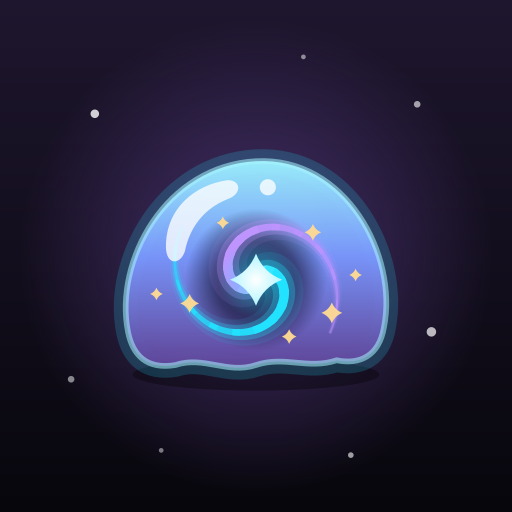

# Void Slime



A 3D slime sandbox for Android (13+), from the VOID family: squish it, make it, sell it. Kotlin +
Jetpack Compose with a hand-written OpenGL ES 2 renderer and soft-body physics, no third-party libraries,
no ads, no accounts. It goes online only to check for its own updates.

It plays in landscape: the menus sit in glass panels around the dish, and every icon, item, customer
and sticker is a custom picture (generated by the scripts in `art/`), with no emoji anywhere.

## Play
The slime is a real soft body (2,562 points on an icosphere held together by springs, a shape memory
and a volume it tries to keep), so it dents, bulges, jiggles and slowly flows back.
- **Poke**: press in and it dents under your finger, with a squelch and a little buzz.
- **Stretch**: grab and pull; pull too far and it *snaps*.
- **Squish**: press flat with your palm and it bulges out the sides.
- **Roll**: a rolling pin flattens it into a sheet.
- **Bubbles**: blow bubbles out of it and pop them.

Each base feels different: Glossy, Clear and Butter to start, then Cloud, Jelly, Icee (it crunches),
Chrome, Holo, Glow (turn the lights off), Floam, Pearl, Magnetic, Thermo (changes colour as you work it)
and Galaxy (twinkling stars inside) from the supply shop.

## Toys
Bought with coins in the shop's Toys tab or straight from the Play toolbar:
- **Slap**: a big wobbly smack.
- **Rake**: drag four tines through it to leave grooves.
- **Star stamp**: press a star into it and leave a print.
- **Sprinkle shaker**: shake sprinkles that land and stick.
- **Magnet**: hold it over the slime and it pulls up into a peak (much stronger on Magnetic slime).
- **Bubble wand**: wave out a cloud of bubbles; golden ones are worth a coin.

## The lab
Six steps: pick a **base**, up to three of 38 **colours** (they swirl rather than blend), **mix-ins**
(foam beads, sprinkles, stars, hearts, pearls, fishbowl beads, sugar crystals, fruit slices,
snowflakes, confetti, micro beads, daisies, moons, gold leaf, gems, gummies) and **glitter**, choose a
**shape**, then pour in the activator and **stir** it until the runny puddle comes together into slime. Name it and it goes into a jar on your shelf.

## Worlds, dishes and shapes
All bought with coins in the shop:
- **Worlds**: the backdrop behind the dish, each with its own effects and its own little song: The Void,
  Sunny meadow, Candy land, Under the sea, Sakura garden, Snowy peaks, Sunset beach, Planet hop and Neon city.
- **Dishes**: the dish outline (Round, Square, Hexagon, Flower, Cloud, Star, Heart) and its colour (marble,
  bubblegum, mint, wood, neon, candy, sunset, ice, starry, gold).
- **Molds**: the shape the slime sets in: Dome, Heart, Star, Cube, Flower, Pudding, Drop, and the animals
  Bear, Bunny and Cat. Any slime can have a cute face.

## And more
- **Shelf**: every slime you've made, in a jar that shows its colours and mix-ins; sort by newest,
  favourites or A–Z, play with any of them again.
- **Slime shop**: customers ask for things ("a glossy slime with stars!"); make it or bring one from the
  shelf and earn coins (up to three stars for getting it right). Spend them on supplies, toys, worlds,
  dishes and molds.
- **Bubble rush**: pop as many bubbles as you can in 45 seconds; golden ones are worth 5.
- **Daily challenges**: three new ones every day, with coins for each and a bonus for all three.
- **Stickers**: 33 to collect for poking, stretching, making and selling, each with a coin reward.
- **A daily gift**: coins, a mystery jar and sometimes a new supply.
- Levels as you play, which bring harder (better paid) orders.

## Feel
Every sound (squelches, pops, crunches, and each world's own little tune) is synthesized in code, and every touch has
matching haptics; music, sounds and haptics each have their own switch in Settings. The seven VOID themes are there too, and
the app icon can follow the theme.

## Updates
Settings › Updates shows the version and checks this repository's GitHub releases (and does so by itself twice a
day, with a notification when there's something new). The download is checked against the published SHA-256
before Android's installer takes it. Void Slime is also in Void Store; both carry the same signed APK, so
either one can update the other's install.

## Build
```
./build.sh testDebugUnitTest assembleRelease   # → VoidSlime.apk
```
Needs `../void-ui` next to it. `./release.sh "What changed"` bumps the version and publishes to Void Store and
GitHub releases. `art/gen_icon.py` regenerates the launcher icons for every theme, and `art/gen_art.py` redraws every
in-game picture into `res/drawable-nodpi` (and writes `ui/Art.kt`).
